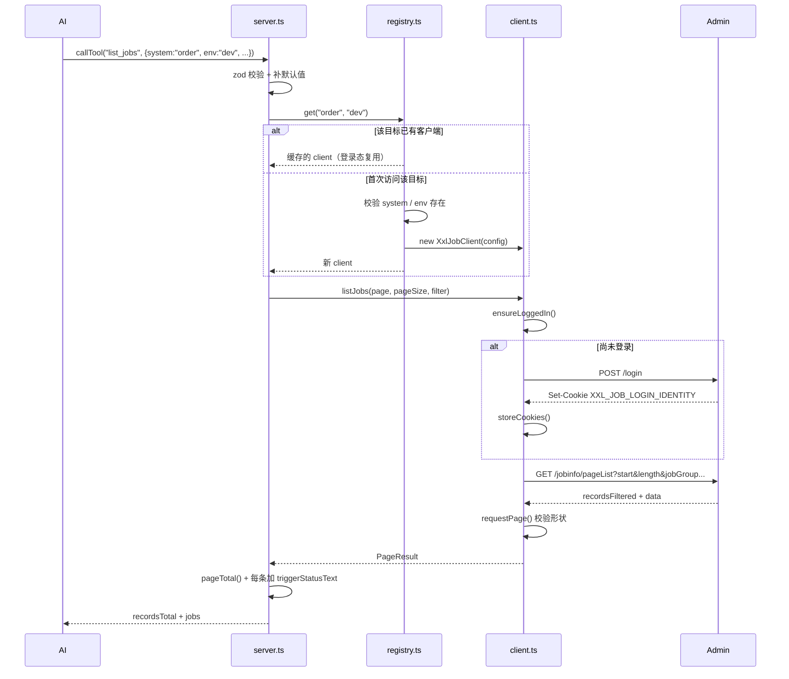

# 架构与功能逻辑

> 面向接手本仓库的人（或 agent）。读完这一篇能回答两个问题：**它是怎么搭起来的**，以及**每个功能背后实际发生了什么**。
> 领域词汇以 [GLOSSARY.md](../GLOSSARY.md) 为准；关键取舍见 [docs/adr/](./adr/)。

## 一句话定位

`multi-xxl-job-mcp` 是一个 **stdio 传输的 MCP Server**：把 XXL-JOB 调度中心的 Web 管理接口，翻译成 12 个 AI 可以直接调用的工具。它自己不调度、不执行、不存数据——**所有状态都在调度中心**，它只是一个带会话的 HTTP 客户端 + 一层工具封装。

## 运行时拓扑


两个容易搞混的点：

- **日志正文不在调度中心**。`/joblog/logDetailCat` 是由调度中心转手向执行器取的，所以调用时必须原样回传 `executorAddress` 和 `triggerTime` ——它们就是定位执行器上那条日志的键。
- **stdio 模式下 stdout 是协议通道**。任何调试输出只能走 stderr，否则会污染 JSON-RPC 流。见 `src/server.ts:447`。

## 代码分层

六个文件，职责单一，依赖是单向的：

```
config.ts ──► registry.ts ──► server.ts
                 │               ▲
                 ▼               │
             client.ts ──────────┤
                 ▲               │
                 └── models.ts ──┘   （类型 + 纯校验函数，无副作用）

cli.ts ──► config.ts   （init 只依赖配置层，不碰 client 与 registry）
```

| 文件 | 职责 | 关键接口 |
|---|---|---|
| `src/config.ts` | 解析 YAML/JSON 配置、`${VAR}` 插值、两层结构校验、统一配置路径 | `loadConfigFromDefaultPath()`、`resolveConfigPath()` |
| `src/registry.ts` | `(system, env)` → 懒创建并缓存的客户端 | `TargetRegistry.get()`、`list()`、`describe()` |
| `src/cli.ts` | `init` 子命令，交互式生成配置 | `runInit()` |
| `src/models.ts` | 与 Admin 对齐的数据结构、默认值、纯校验 | `JOB_DEFAULTS`、`validateSchedule()`、`pageTotal()` |
| `src/client.ts` | 会话管理 + 13 个 Admin 接口的封装 | `XxlJobClient` |
| `src/server.ts` | 工具注册、参数 schema、结果整形、CLI 子命令分发 | `buildServer(registry)`、`main()` |

这个分层有两个明确的设计意图：

1. **`buildServer(registry)` 接受注入的注册表，而不是自己读配置**。测试可以在不启动真实 Admin、也不写配置文件的情况下，把一份内存配置塞进去跑工具逻辑。
2. **`TargetRegistry` 接受注入的客户端工厂**。测试因此可以用假客户端验证「同目标复用、不同目标隔离」，完全不发网络请求（`tests/registry.test.ts`）。

这两条缝让整套逻辑都可以在没有外部依赖的情况下被验证——目前 4 个测试文件共 161 项断言，全部离线运行。

## 一次工具调用的完整生命周期

以 `list_jobs` 为例：



三个值得注意的点：

- **目标校验先于任何网络请求**。未知 `system`/`env` 在 `registry.get()` 就抛错，不会产生副作用——这对 `remove_job` 尤其重要。
- **参数补默认值与响应整形都在 server 层**，client 只管忠实转发，因此 client 可以被 test-client 之类的脚本直接复用。
- **每个目标一份独立的 client 与会话**。order/dev 与 order/prod 各自登录、各自持 Cookie，互不影响。

## 四个贯穿全局的设计

这四条解释了这个仓库里大部分「看起来奇怪」的代码。

### 1. 会话：一份 Cookie，失效只重登一次

`XxlJobClient` 在内存里维护一个 `Map` 存 Cookie。**每个目标一个独立实例**，所以会话天然隔离——不需要按目标给 Cookie 加前缀，也不需要担心串号。

三个机制配合：

- `ensureLoggedIn()`（`client.ts:67`）用 `loggingIn` 这个 Promise 做闸门，多个工具并发调用时只真正登录一次。
- `requestOnce()`（`client.ts:183`）遇到 302 跳登录页，就把 `loggedIn` 置回 false、重新登录、**重试一次**。只重试一次是有意的：无限重试会在密码错时打成死循环。
- `isAuthRedirect()`（`client.ts:120`）除了查 302，还会看 HTML 响应体里有没有 `login` ——因为部分版本的 Admin 不返回 302，而是直接吐登录页 HTML。

### 2. 两套响应形状，三条请求通道

Admin 的接口不一致，这是**真实世界的约束**，不是本项目的选择：

| 通道 | 方法 | 用于 | 响应 |
|---|---|---|---|
| ReturnT | `request()` `client.ts:160` | 登录、增删改、启停、触发、详情 | `{code, msg, content}`，code 非 200 抛错 |
| 裸分页 | `requestPage()` `client.ts:175` | `pageList` 系列 | `{recordsTotal/recordsFiltered, data}`，无 code |
| 原始 | `requestRaw()` `client.ts:151` | 上面两者的公共底座 | 原样 JSON |

把 `pageList` 当 ReturnT 解析会直接抛「意外的响应结构」，所以三条通道不能合并。`pageTotal()` 存在的理由同理：标准版返回 `recordsTotal`，部分二开版返回 `recordsFiltered`。

### 3. 改任务：读取 → 合并 → 写回

`update_job` **不是**直接把调用方传的字段提交。流程是（`server.ts:241-265`）：

1. `getJobById(jobId)` 拿到现有全量配置
2. `jobToForm()` 转成 Admin 的扁平表单字段
3. 只把**本次显式传入**的字段覆盖上去
4. `POST /jobinfo/update` 提交完整表单
5. 再 `getJobById` 一次，把修改后的完整配置回给调用方

为什么要这么绕：Admin 的 update 接口是**整体覆盖**语义，少传一个字段就等于把它清空。多两次往返换来的是「改一个 Cron 不会顺手把 JobHandler 抹掉」。见 ADR-0002。

### 4. 版本兼容：能降级就降级，降不了就明说

XXL-JOB 各版本／二开版接口有差异，代码里能看到三处显式处理：

- **`/jobinfo/getById` 可能不存在** → 报错信息匹配到「非 JSON 内容／意外的响应结构」时，降级为分页扫描（`client.ts:283`，上限 50 页 × 100 条）。
- **空字符串参数不能过滤掉**（`client.ts:191`）→ 部分版本把 `appname`／`jobDesc` 等标为必填，缺了直接 HTTP 400，所以显式传空串。
- **`logDetailCat` 可能不返回 `isEnd`**（`client.ts:385`）→ 用「内容为空」推断已读完，避免调用方无限续读。

## 13 个工具

按功能分组。**除 `list_instances` 外，每个工具都必须传 `system` 与 `env`**。完整参数 schema 见 `src/server.ts`，这里只记**语义上必须知道的**。

### 目标发现

| 工具 | 底层 | 要点 |
|---|---|---|
| `list_instances` | 无网络请求 | 读注册表内存中的配置，按系统分组；**不含密码**；`usesEnvVars` 标记该目标是否用了插值 |

### 执行器组

| 工具 | 底层接口 | 要点 |
|---|---|---|
| `list_job_groups` | `GET /jobgroup/pageList` | 新增任务前先查组 id；返回含在线机器地址 |

### 任务

| 工具 | 底层接口 | 要点 |
|---|---|---|
| `list_jobs` | `GET /jobinfo/pageList` | jobGroup=0 表示全部，triggerStatus=-1 表示全部状态 |
| `get_job` | `GET /jobinfo/getById` | 接口缺失时降级分页扫描 |
| `add_job` | `POST /jobinfo/add` | 默认停止状态；未传字段取 `JOB_DEFAULTS`；返回新 id |
| `update_job` | getById + `POST /jobinfo/update` | 读取-合并-写回；**不处理启停** |
| `remove_job` | `POST /jobinfo/remove` | 不可恢复；**强制显式传目标**，未知目标在发起请求前就失败 |
| `start_job` | `POST /jobinfo/start` | 只切换调度状态，不立即执行 |
| `stop_job` | `POST /jobinfo/stop` | 停止自动调度，配置保留 |
| `trigger_job` | `POST /jobinfo/trigger` | 立即执行一次，**不影响** triggerStatus |
| `preview_next_trigger_times` | `GET /jobinfo/nextTriggerTime` | 只接受 CRON／FIX_RATE；不落库，纯预演 |

### 日志

| 工具 | 底层接口 | 要点 |
|---|---|---|
| `list_job_logs` | `POST /joblog/pageList` | 返回两段结果文本；是拉正文的入口 |
| `get_job_log_content` | `GET /joblog/logDetailCat` | 按行增量；续读传上次 toLineNum + 1，isEnd=true 停 |

**增量拉取怎么用**：`list_job_logs` → 取某条的 `id`／`executorAddress`／`triggerTime` → 传给 `get_job_log_content`（首次 fromLineNum=1）→ 没读完就 toLineNum+1 再来。三个参数缺一不可，因为日志正文要按 (logId, address, triggerTime) 三元组去执行器上定位。

## 已知脆弱点

以下都是**读代码 + 可执行验证**得出的，不是猜测。写在这里是为了让下一个人不必重新踩一遍。修复与否需要单独决策，本文档不擅自改代码。

| # | 现象 | 位置 | 证据 | 影响 |
|---|---|---|---|---|
| 1 | ~~Node **< 18.15** 上登录「成功」但 Cookie 存不下，之后每个请求都报「登录态失效」~~ **已修复** | `client.ts:78` 的 `resp.headers.getSetCookie?.()` 在缺失时静默取空数组 | 在 Node 18.14.0 实跑集成测试：23 项断言大面积失败；18.15.0 起全部通过 | `package.json` 声明 engines.node >= 18，实际需要 **>= 18.15**。**修复方式**：`engines.node` 收紧为 `>=18.15`，CI matrix 增加 `18.15.0` 一格以照住下限（只写 `18` 会解析到 18.x 最新，测不到下限）。**后续变更**：项目已确定只以当前开发版本为基线、不再承诺向下兼容，`engines.node` 现为 `>=26`，CI 收敛为单一 Node 版本（读 `.node-version`），上述多版本 matrix 已移除 |
| 2 | ~~HTML 响应抛 `TypeError: Body is unusable`~~ **已修复** | 根因是 `isAuthRedirect()` 先消费了响应体，`parseReturnT()` 再读一次 | 回归测试 `test:regression` 覆盖：网关错误页现在抛可读的 `XxlJobApiError`，并附带响应片段 | 修复方式：响应体统一走带缓存的 `readBody()`，同一响应只消费一次 |
| 3 | ~~handleCode=502 被显示成「未完成」~~ **已修复** | 上游 `XxlJobContext.HANDLE_CODE_TIMEOUT = 502` | 回归测试覆盖 0/1/2/200/500/502 六个状态码的映射 | 修复方式：抽出 `handleResultText()`，502 单独显示为「执行超时」——超时是已结束的失败，与「仍在执行」必须区分 |
| 4 | ~~`remove_job` 没有任何测试~~ **已修复** | 根因是 `tests/mock-admin.ts` 从未实现 `/jobinfo/remove` 端点 | 多系统改造中补上该端点，`remove_job` 现由集成测试端到端覆盖 | — |
| 5 | ~~`trigger_job` 里的 code 检查是死代码~~ **已修复** | `request()` 已在返回前对非 200 抛错 | 回归测试验证 trigger 行为不变 | 删除冗余判断，减少读码噪声 |
| 6 | ~~`get_job_log_content` 的 `triggerTime` 产出 `type: ["number","string"]`，部分客户端拒收整个工具~~ **已修复** | `server.ts` 的 `triggerTime: z.union([...])` —— zod 对基本类型 union 必然产出 type 数组 | MCP Inspector 的 `--strict` 可复现；smoke 现加了 type 数组扫描守卫 | **修复方式**：改为 `z.union([z.string(), z.int()])`，zod 因此输出 `anyOf`（每个分支单一 type），运行时接受范围不变（number / string 都收，对象等被拒） |

## 测试怎么分工

| 命令 | 需要什么 | 覆盖什么 |
|---|---|---|
| `npm run test:config` | 无 | 配置解析 33 项：YAML/JSON、插值、结构校验、权限、统一路径 |
| `npm run test:registry` | 无 | 注册表 53 项：同目标复用、跨目标隔离、未知目标错误、不泄漏密码 |
| `npm run test:cli` | 无 | init 子命令 37 项：默认值、覆盖确认、EOF 中断、权限 600 |
| `npm run test:regression` | 无 | 已验证脆弱点的回归 13 项：HTML 响应只读一次、登录页识别、状态码映射 |
| `npm run test:dev` | 无 | 调试脚手架 23 项：固定端口、端口冲突、参数校验与顺序 |
| `npm run smoke` | 无 | 13 个工具注册 + 「所有操作类工具都要求 system/env」 |
| `npm run test:integration` | 无（自带两个 Mock Admin） | 全链路 41 项，含目标隔离、未知目标无副作用、remove_job 端到端 |
| `npm run test:client` | 真实 Admin + 已生成的配置 | 只读联调：登录、查组、查任务、查日志正文 |

除 `test:client` 外全部不需要网络。**文件数与断言数以 `package.json` 的脚本和实际输出为准**，
不在这里写死——上面这张表本身也只是分工说明，别当成计数依据。

`tests/mock-admin.ts` 是这套测试能「零依赖」的关键：它按真实 Admin 的语义实现了登录、302 拦截、ReturnT 与裸分页两种响应形状，启动端口默认随机（`0`），也可传 `port` 固定——**起两个即为两个独立目标**，集成测试正是这样验证目标隔离的。

> 教训：`remove_job` 长期没有测试，不是「忘了写」，而是 mock 里根本没有 `/jobinfo/remove` 端点，无从测起。**改 client 时如果新增接口，要在 mock 里补对应端点**，否则测试会静默漏掉整条路径。

## CI 运维：macOS runner 偶发排队取消

macOS 那一格偶尔会以**红灯**收场，但**代码没问题**。判断标准只有两条，都成立即为基础设施问题：

1. `conclusion` 是 `cancelled`（不是 `failure`）
2. `runner_name` 为空，或 job 在 `queued` 状态停留十几分钟

原因：GitHub 托管 macOS runner 的并发池很小，高峰期要排队；超过约 15 分钟未分配就会被取消。此时 job **从未执行过任何测试**，红灯不代表代码有问题。

**处置：直接重跑，不要改代码、不要放宽门禁。**

```bash
# 查这个 job 到底是失败还是没跑起来
gh api repos/<owner>/<repo>/actions/jobs/<job-id> \
  --jq '{status, conclusion, runner_name, started_at, completed_at}'
```

对照：正常运行时 macOS job 约 **12–20 秒**结束；一旦耗时以「分钟」计且 `runner_name` 为空，就是排队。

> 实测案例：本仓库曾连续两次因此变红（`runner_name` 均为空、排 15 分钟后 cancelled），第三次重跑 12 秒通过，代码一行未改。

## 读代码的建议顺序

1. `src/config.ts` —— 配置从哪来、长什么样、如何校验
2. `src/registry.ts`（约 220 行）—— 目标如何寻址、客户端如何复用
3. `src/models.ts` —— 数据结构 + 默认值，决定了工具参数长什么样
4. `src/client.ts:96-218` —— 请求通道与会话，理解其余部分的前提
5. `src/server.ts` 的 `jobToForm` —— 看懂它就看懂了 update 的坑
6. 剩下的工具注册可以挑着看，都是同一套模式